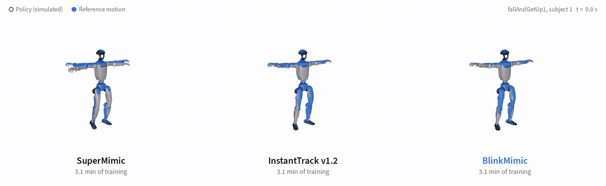
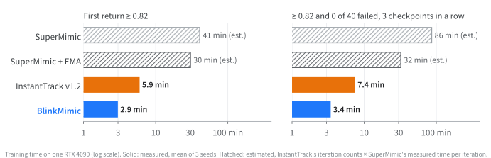
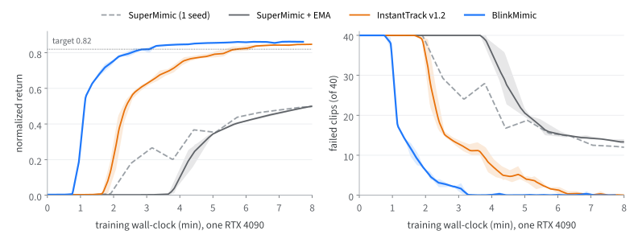

# BlinkMimic

本工作区已增加 **Unitree H1（19 关节）训练支持**，保留原有 G1 入口。下面原作者的速度和跟踪成绩均为 G1 实验，不能视为 H1 训练结果。

H1 使用独立的模型、关节/执行器配置和 NPZ 加载器：物理根为 `pelvis`，跟踪锚点为 `torso_link`。默认策略观测为 72 维（含相对锚点旋转和位置），10 帧历史为 720 维，10 帧参考目标为 530 维，动作 19 维。世界模型、策略和 Critic 从头训练；SuperMimic 权重不能直接恢复。

在仓库内安装独立环境并准备数据：

```bash
cd /home/ljp/human_learn/blinkmimic-main
env -u PYTHONPATH -u PYTHONHOME uv sync --locked --python 3.12
PYTHONPATH=src .venv/bin/python tools/prepare_h1.py \
  --source /home/ljp/human_learn/SuperMimic_trian4090-main
```

准备工具复制实际文件内容，保留 H1 XML、网格、初始关节角、PD 增益、力矩限制、被动阻尼和动作缩放；不会修改源仓库。当前导入 47 个 50 Hz 动作，并生成 `data/h1_manifest.json`。清单固定文件名和 SHA-256，新增文件不会自动混入训练；需要扩展清单时重新准备，并显式使用 `--overwrite`。`--motion_manifest` 可选择另一个同格式清单。

先检查环境和小规模训练：

```bash
bash scripts/train_h1.sh logs/h1_debug --profile debug \
  --motion_manifest data/h1_manifest.json
```

`debug` 使用 32 环境、WM batch=64、policy batch=32，保留 H=32、k=8 和完整策略网络，关闭编译、镜像、接触奖励和探测；300 轮中前 100 轮预热世界模型。它用于验证训练链路，不代表收敛。其它配置：

| profile | 用途 |
|---|---|
| `local`（默认） | 8 GB 显存的小规模训练起点；32 环境，启用结构化世界模型、参考动作跳连、EMA、镜像和接触奖励 |
| `4090` | 4096 环境、WM/policy batch=2048，加入 Muon 和编译，保留 500 轮世界模型预热 |
| `fast` | 原 BlinkMimic 的 CUDA Graph、采集图、掩码重置与同步评估探测；H1 初始 LR=2e-4、倍率 1、预热 200 轮；异步探测默认关闭 |

```bash
bash scripts/train_h1.sh logs/h1_local --profile local
bash scripts/train_h1.sh logs/h1_4090 --profile 4090 --max_hours 4
# 恢复时继续使用同一个 profile、网络定义和动作清单；last.pt 包含优化器状态。
bash scripts/train_h1.sh logs/h1_4090_resume --profile 4090 \
  --resume logs/h1_4090/last.pt --iterations 20000
```

末尾参数覆盖 profile 的数值参数。布尔开关不能通过追加 `0` 关闭，应选择合适 profile；`fast` 可用 `--eprobe_share 0` 关闭探测。检查点校验机器人模型、控制和观测定义，恢复训练还校验动作文件内容。

H1 训练保留已成功方案中的手臂跟踪（1.0/std 0.5）、手臂请求目标越界惩罚（-0.2）、水平漂移代价（-0.5/scale 1m）和宽范围航向奖励（0.5）。这些增强仅作用于想象训练奖励；仿真采样、探测和固定评估仍使用基础奖励，归一化上限为每步 0.1。对应参数为 `--w_arm_joint_pos`、`--std_arm_joint_pos`、`--w_arm_target_limit`、`--w_planar_drift`、`--planar_drift_scale`、`--w_heading`。

接触奖励和指标统一使用 H1 足部碰撞网格在 body 坐标系中的包围盒角点，而不是 G1 的踝关节高度。穿地和滑移为该几何近似下的指标；足底高度阈值为 1.5cm。H1 腰部镜像符号显式设为 -1，FK 镜像关系有回归测试。原始参考动作的世界位置和高度保持不变。

评估、录制和导出示例：

```bash
.venv/bin/python -m blinkmimic.evaluate --robot h1 --run_dir logs/h1_local \
  --ckpt logs/h1_local/last.pt --motion_manifest data/h1_manifest.json
PYTHONPATH=src .venv/bin/python tools/eval_batch.py --robot h1 --run_dir logs/h1_local --group 2
PYTHONPATH=src .venv/bin/python tools/eval_metrics.py --robot h1 logs/h1_local/last.pt \
  --motion_manifest data/h1_manifest.json --out results/h1_metrics
.venv/bin/python -m blinkmimic.evaluate --robot h1 --run_dir logs/h1_local \
  --ckpt logs/h1_local/last.pt --motion_manifest data/h1_manifest.json --record results/h1_traj.npz
PYTHONPATH=src uv run --with imageio-ffmpeg python tools/render.py results/h1_traj.npz results/h1.mp4 \
  --robot h1 --clips walk1_subject1 --seconds 5
uv run --with onnx --with onnxruntime python tools/export_onnx.py --robot h1 \
  --ckpt logs/h1_local/last.pt --motion data/npz/h1/walk1_subject1.npz --out results/h1_walk.onnx
```

指标增加根部水平位置、航向和逐关节误差。H1 渲染默认显示世界坐标中的参考重影，可用 `--local_ghost` 查看局部姿态。ONNX 元数据包含 72 维观测顺序、控制参数和模型身份；额外输出 `next_anchor_pos_w`，与 `next_anchor_quat_w` 一起用于下一帧相对锚点反馈。位置反馈需要机器人位置估计，当前验证范围为仿真训练与评估。

本次实现细节、逐文件位置及验证记录见 [H1 迁移实施说明](docs/H1迁移实施说明.md)。按要求，验证结束后测试脚本与临时产物已清理。

**Whole-body motion tracking for the Unitree G1 in about 3 minutes on one RTX 4090.**

BlinkMimic trains one policy for all 40 LAFAN1 clips (2.45 h of motion) to an evaluation normalized return of 0.82
in **2.9 min of training on one RTX 4090** (mean of 3 seeds), and to 0.82 with 0 of 40 clips failed for 3
checkpoints in a row in **3.4 min**.

Like SuperMimic and InstantTrack, BlinkMimic learns one differentiable world model and trains the policy by backpropagation through
imagined rollouts, on [mjlab](https://github.com/mujocolab/mjlab) / MuJoCo Warp. BlinkMimic changes how the policy
is optimized and where the simulator spends its resets ([details](#what-blinkmimic-changes)).



*Each policy after 3.1 min of training (seed 0), on `fallAndGetUp1_subject1`: the first 8 s, then 30–42 s,
simulated in MuJoCo Warp under evaluation conditions. Blue ghost: reference motion. A faded panel has fallen.*

## Results

All runs on one RTX 4090 (driver 580, CUDA 12.8, torch 2.9.0), the GPU otherwise idle. 40 LAFAN1 clips; every
checkpoint (one per 100 iterations) evaluated on all 40 clips from their first frame with 4 replicas; return and
failed clips are averaged over the replicas. Minutes are training wall-clock, including compilation, CUDA-graph capture, probe sweeps and
checkpointing, excluding process start-up and data loading.



### Time to target

| | seeds | first return ≥ 0.82 (min) | ≥ 0.82 and 0 failed, 3 checkpoints in a row (min) | iterations to first ≥ 0.82 | ms / iteration |
|---|---|---|---|---|---|
| SuperMimic | (1) | ≈ 41 (estimated) | ≈ 86 (estimated) | 7898 | 310 |
| SuperMimic + EMA | (3) | ≈ 30 (estimated) | ≈ 32 (estimated) | 5749 / 6000 / 5856 | 310 |
| InstantTrack v1.2 | 3 | 5.59 / 6.31 / 5.78 (**5.89**) | 7.29 / 8.52 / 6.28 (**7.36**) | 2500 / 2800 / 2500 | 141 |
| **BlinkMimic** | 3 | 2.89 / 3.28 / 2.64 (**2.94**) | 3.32 / 3.28 / 3.53 (**3.38**) | 1300 / 1500 / 1200 | 133 |

"First return ≥ 0.82" is SuperMimic's metric, the strict column InstantTrack's. ms / iteration = training
wall-clock / iterations.
SuperMimic times are estimated: the iterations at which InstantTrack's SuperMimic runs reach the target (strict:
16665; 5749 / 6000 / 6971) × 310 ms per iteration, measured for SuperMimic on our RTX 4090.

BlinkMimic is 6% cheaper per iteration than InstantTrack v1.2 and needs about half the iterations.

With 6 checkpoints in a row instead of 3, BlinkMimic reaches the target in 2 of 3 seeds (5.36, 3.53 min) and
InstantTrack v1.2 in 1 of 3 within 4500 iterations.

### Equal training time

Mean return / failed clips (of 40) at the last checkpoint within the budget. These SuperMimic runs took 331–348 ms
per iteration (310 ms above).

| training time | SuperMimic (1 seed) | SuperMimic + EMA (3 seeds) | InstantTrack v1.2 (3 seeds) | **BlinkMimic** (3 seeds) |
|---|---|---|---|---|
| 3.1 min | 0.179 / 29.2 | 0.002 / 40 | 0.639 / 12.3 | **0.821 / 1.5** |
| 4.5 min | 0.367 / 16.8 | 0.231 / 28.9 | 0.767 / 5.0 | **0.851 / 0** |
| 7.8 min | 0.495 / 12.2 | 0.480 / 14.0 | 0.846 / 0.1 | **0.861 / 0** |



### Tracking quality at equal training time

Mean of 3 seeds, one deterministic rollout per clip (`tools/eval_metrics.py`), at iteration 2000 (4.3–4.6 min) and at
the last checkpoint within 7.8 min (v1.2: iteration 3400; BlinkMimic: 3500).

| training time | method | return ↑ | failed clips ↓ | body pos (cm) ↓ | body ori (°) ↓ | joints (°) ↓ | foot slip (cm/s) ↓ | contact agreement ↑ | penetration (mm) ↓ |
|---|---|---|---|---|---|---|---|---|---|
| 4.4 min | InstantTrack v1.2 | 0.765 | 5.3 | 5.15 | 10.3 | 4.85 | 7.75 | 0.746 | 0.079 |
| 4.4 min | **BlinkMimic** | **0.851** | **0.3** | **3.74** | **7.37** | **3.99** | **6.87** | **0.757** | **0.061** |
| 7.8 min | InstantTrack v1.2 | 0.847 | 0 | 4.07 | 8.29 | 4.77 | 7.18 | **0.775** | 0.061 |
| 7.8 min | **BlinkMimic** | **0.862** | 0 | **3.44** | **7.02** | **4.19** | **6.66** | 0.765 | **0.058** |

Foot slip of the reference motion itself: 10.2 cm/s.

## What BlinkMimic changes

| | SuperMimic ([supermimic_vibed](https://github.com/zita-ch/supermimic_vibed)) | InstantTrack v1.2 | BlinkMimic | flag |
|---|---|---|---|---|
| policy EMA, resets before recent failure points, contact reward, world model 3 × 1024, learning rate 4e-4 | – | ✓ | ✓ | `PRESET[instanttrack]` |
| no host synchronization in the update loop, fused Adam, fused rotations, more of the step compiled | – | ✓ | ✓ | |
| Muon on the hidden weight matrices of policy and world model (Jordan et al. 2024; Liu et al. 2025) | – | ✓ | ✓ | `--pi_opt muon --wm_opt muon` |
| world-model and policy updates as CUDA graphs | – | ✓ | ✓ | `--cuda_graph` |
| goal encoding batched before each imagined rollout (same result, fewer kernels) | – | ✓ | – | |
| action built on the reference pose | – | ✓ | ✓ | `--pi_ref_skip` |
| policy encoder / decoder | 2048-1024-512-256 | 1024-512-256 | 2048-1024-512-256 | `--enc_hidden --dec_hidden` |
| world-model-only warm-up | 500 iterations | 500 iterations | none | `--wm_only_iters 0` |
| semi-implicit world model: predicts velocity increments and integrates positions | – | – | ✓ | `--wm_structured` |
| left-right mirror augmentation of half of each world-model batch | – | – | ✓ | `--wm_mirror 0.5` |
| reset-statistics fixes (duplicate bins; per-clip contact floor of the contact reward) | – | – | ✓ | `--bin_fix --ref_contact_fix` |
| evaluation-guided resets: from iteration 1000, every 125 iterations the deployed policy is swept over all clips under evaluation conditions; 15% of the resets go to the 10 s before the places where it fails | – | – | ✓ | `--eprobe_*` |
| imagined-rollout batch (policy and critic) | 4096 | 4096 | 2048, policy learning rate 4×, decayed to 1× over 300 iterations once the training return reaches 0.75 (by iteration 1400) | `--pi_batch --pi_lr_mult --lr_decay_*` |
| collection step, episode resets and probe sweep as CUDA graphs; sweep on a side stream; checkpoints written by a background thread | – | – | ✓ | `--graph_early --collect_graph --reset_masked --eprobe_graph --eprobe_async --ckpt_light` |

The released recipe is `PRESET[main]` in [`scripts/presets.sh`](scripts/presets.sh). `python -m blinkmimic.train`
without flags is the SuperMimic baseline; all methods share simulator, MDP, reward and evaluator.

## Setup

Linux x86_64, an NVIDIA GPU with a driver for CUDA 12.8, [uv](https://docs.astral.sh/uv/), `git`, `curl`, `python3`
(and `ffmpeg` for videos).

```bash
git clone https://github.com/fuyichen0725/blinkmimic.git
cd blinkmimic
uv sync                          # .venv with mjlab, MuJoCo Warp, Warp, torch 2.9.0 (CUDA 12.8)
tools/download_data.sh           # 40 G1-retargeted LAFAN1 clips + G1 description -> data/
uv run python -m blinkmimic.train --help  # check the installed training entry point
```

## Train, evaluate, reproduce

> **Train on an otherwise idle GPU.** On a shared GPU, `--eprobe_async` can crash with an illegal memory access;
> add `--eprobe_async 0` there.

```bash
bash scripts/train.sh logs/run_s0 --seed 0          # ~8 min: 3500 iterations, a policy checkpoint every 100
uv run python tools/eval_batch.py --run_dir logs/run_s0 --group 18 --reps 4   # 18 checkpoints per batch
uv run python tools/time_to_target.py logs/run_s0
bash scripts/reproduce.sh logs/reproduce             # the table above: 3 seeds, evaluation, time to target
```

Other tools: `tools/eval_metrics.py` (accuracy and contact metrics), `tools/render.py` (videos from
`python -m blinkmimic.evaluate --record`), `tools/export_onnx.py` and `tools/play_onnx.py` (deployment format and a
check of it in the simulator; `play_onnx.py` needs `onnxruntime`: `uv run --with onnxruntime python tools/play_onnx.py ...`).

## Attribution and licenses

- **Code.** BlinkMimic builds on [supermimic_vibed](https://github.com/zita-ch/supermimic_vibed) (Chong Zhang,
  ETH Zurich) and [InstantTrack](https://github.com/Huy-Quang-Dao/instantTrack) (Huy-Quang-Dao), both MIT-licensed;
  their notices are in [THIRD_PARTY_NOTICES.md](THIRD_PARTY_NOTICES.md).
- **Method.** SuperMimic (Liao et al., arXiv:2610.28480, 2026). InstantMimic (Choi, Leem, Won, arXiv:2609.09821,
  2026) for the GPU-native training loop. SuperTrack (Fussell, Bergamin, Holden, 2021) and SHAC (Xu et al., 2022)
  for learning through a differentiable model. BeyondMimic (Liao et al., arXiv:2508.08241, 2025) for the reward and the evaluation
  protocol. Muon (Jordan et al., 2024; Liu et al., "Muon is Scalable for LLM Training", 2025).
- **Also consulted.** [rethinking-supermimic](https://github.com/btx0424/rethinking-supermimic) (btx0424) and the
  SuperMimic reimplementations listed in [awesome-supermimic](https://github.com/miao-org/awesome-supermimic).
- **Simulation.** [mjlab](https://github.com/mujocolab/mjlab), [MuJoCo](https://mujoco.org),
  [MuJoCo Warp](https://github.com/google-deepmind/mujoco_warp), [NVIDIA Warp](https://github.com/NVIDIA/warp)
  (Apache-2.0) and [PyTorch](https://pytorch.org) (BSD-3-Clause).
- **Data.** LAFAN1 motions by Ubisoft La Forge (Harvey et al., SIGGRAPH 2020), license **CC BY-NC-ND 4.0**; G1
  retargets and robot description by Unitree (BSD-3-Clause), via the Hugging Face dataset
  `lvhaidong/LAFAN1_Retargeting_Dataset`. The data are not included here. The GIF and trained checkpoints are
  derived from LAFAN1: non-commercial research use only, not under this repository's MIT License.

## Citation

```bibtex
@misc{blinkmimic2026,
  title  = {BlinkMimic: Whole-Body Motion Tracking for the Unitree G1 in Minutes on One GPU},
  author = {Chen, Fuyi},
  year   = {2026},
  url    = {https://github.com/fuyichen0725/blinkmimic}
}
```

Please also cite the works it builds on:

```bibtex
@article{liao2026supermimic,
  title   = {SuperMimic: Scaling Humanoid Whole-Body Control with One Differentiable World Model},
  author  = {Liao, Qiayuan and Shao, Yiyang and Long, Junfeng and Zakka, Kevin and Horowitz, Roberto and Abbeel, Pieter and Sreenath, Koushil},
  journal = {arXiv preprint arXiv:2610.28480},
  year    = {2026}
}
@misc{zhang2026supermimicvibed,
  title  = {supermimic\_vibed: An Unofficial Reimplementation of SuperMimic},
  author = {Zhang, Chong},
  year   = {2026},
  url    = {https://github.com/zita-ch/supermimic_vibed}
}
@misc{instanttrack2026,
  title  = {InstantTrack: Whole-Body Motion Tracking for the Unitree G1 in 15 Minutes on One GPU},
  author = {Huy-Quang-Dao},
  year   = {2026},
  url    = {https://github.com/Huy-Quang-Dao/instantTrack}
}
@article{choi2026instantmimic,
  title   = {InstantMimic: A High Performance System for Learning Physics-based Skills in Seconds},
  author  = {Choi, Ikjun and Leem, Geonho and Won, Jungdam},
  journal = {arXiv preprint arXiv:2609.09821},
  year    = {2026}
}
@article{liao2025beyondmimic,
  title   = {BeyondMimic: From Motion Tracking to Versatile Humanoid Control via Guided Diffusion},
  author  = {Liao, Qiayuan and Truong, Takara E. and Huang, Xiaoyu and Tevet, Guy and Sreenath, Koushil and Liu, C. Karen},
  journal = {arXiv preprint arXiv:2508.08241},
  year    = {2025}
}
@misc{zakka2026mjlab,
  title         = {mjlab: A Lightweight Framework for GPU-Accelerated Robot Learning},
  author        = {Zakka, Kevin and Liao, Qiayuan and Yi, Brent and Le Lay, Louis and Sreenath, Koushil and Abbeel, Pieter},
  year          = {2026},
  eprint        = {2601.22074},
  archivePrefix = {arXiv},
  primaryClass  = {cs.RO}
}
@inproceedings{todorov2012mujoco,
  title     = {MuJoCo: A physics engine for model-based control},
  author    = {Todorov, Emanuel and Erez, Tom and Tassa, Yuval},
  booktitle = {IEEE/RSJ International Conference on Intelligent Robots and Systems},
  pages     = {5026--5033},
  year      = {2012}
}
@misc{mujocowarp2025,
  title  = {MuJoCo Warp: GPU-accelerated MuJoCo with NVIDIA Warp},
  author = {{Google DeepMind and NVIDIA}},
  year   = {2025},
  url    = {https://github.com/google-deepmind/mujoco_warp}
}
@article{harvey2020robust,
  title   = {Robust Motion In-betweening},
  author  = {Harvey, F{\'e}lix G. and Yurick, Mike and Nowrouzezahrai, Derek and Pal, Christopher},
  journal = {ACM Transactions on Graphics (Proceedings of ACM SIGGRAPH)},
  volume  = {39},
  number  = {4},
  pages   = {60:1--60:12},
  year    = {2020}
}
@misc{jordan2024muon,
  title  = {Muon: An optimizer for hidden layers in neural networks},
  author = {Jordan, Keller and Jin, Yuchen and Boza, Vlado and You, Jiacheng and Cesista, Franz and Newhouse, Laker and Bernstein, Jeremy},
  year   = {2024},
  url    = {https://kellerjordan.github.io/posts/muon/}
}
@article{liu2025muon,
  title   = {Muon is Scalable for LLM Training},
  author  = {Liu, Jingyuan and Su, Jianlin and Yao, Xingcheng and Jiang, Zhejun and Lai, Guokun and Du, Yulun and Qin, Yidao and Xu, Weixin and Lu, Enzhe and Yan, Junjie and others},
  journal = {arXiv preprint arXiv:2502.16982},
  year    = {2025}
}
```

## License

MIT ([LICENSE](LICENSE)). Copyright (c) 2026 Fuyi Chen; portions Copyright (c) 2026 Huy-Quang-Dao (InstantTrack) and
(c) 2026 ETH Zurich, Chong Zhang (supermimic_vibed). Data-derived files are excluded; see above.
